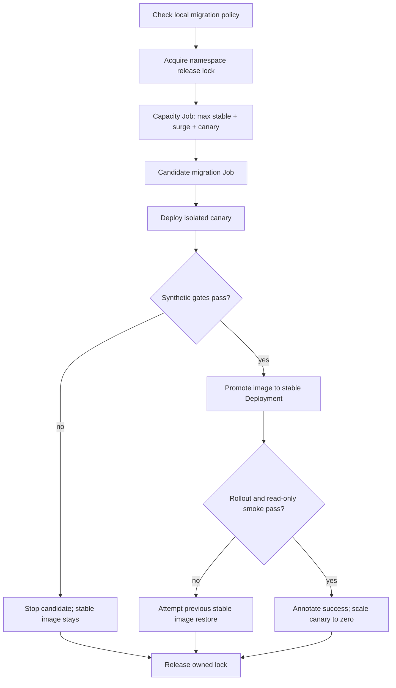

# Kubernetes release automation

[Documentation index](../../../docs/README.md) · [First installation](../../../docs/DEPLOYMENT.md#first-kubernetes-installation) · [Operations](../../../docs/OPERATIONS.md)

## Prerequisites

This script upgrades an **existing** stable Deployment named `nearby-location`; it does not bootstrap a cluster. It expects its API container to be named `nearby-location`, the stable Service, ConfigMap `nearby-location-config`, Secret `nearby-location-secrets`, a reachable PostGIS database, and optional HPA named `nearby-location`.

Supply a published immutable image digest containing the release's application, tools, and migrations. The checkout's migration files must correspond to that candidate image: the local policy check cannot validate a different image's migrations.

The runner needs Bash, Node.js, `kubectl`, cluster credentials, and permissions to read/update Deployments, update their scale, read HPA, create/read/delete the lock ConfigMap, create/read Jobs, read pods/logs, and apply the canary Service/Deployment. Adapt [release RBAC](../release-rbac.example.yaml) to your subject and namespace. API/migration pods do not need a mounted cluster token.

Configuration/secret updates are a separate release responsibility. Record previous values and ensure both stable and candidate remain compatible. Network policy must admit the gate/smoke Jobs and the database tools where required.

## Invoke a release

Set `IMAGE_REF` to the real `registry/repository@sha256:<64 hex>` digest and `KUBE_NAMESPACE` to the intended namespace. Confirm cluster identity first:

```bash
kubectl config current-context
kubectl -n "$KUBE_NAMESPACE" get deployment nearby-location
export IMAGE_REF KUBE_NAMESPACE
RELEASE_OBSERVATION_SECONDS=60 ./deploy/kubernetes/release/release.sh
```

Export the selected values so the child script receives them; shell-local assignments alone are not inherited. The script refuses mutable references by default. `RELEASE_ALLOW_MUTABLE_IMAGE=true` is for non-production testing only. Preserve script output and Job logs promptly; template Jobs have a completion TTL.

The GitHub [release workflow](../../../.github/workflows/release-canary.yml) dispatches this script manually with image/namespace/observation inputs, a `production` environment, and `KUBE_CONFIG_B64`. It serializes workflow releases but requires cluster credential and environment setup. Environment approval behavior depends on your GitHub settings; the workflow alone does not define it.

## Release flow



The canary Service has a distinct selector; stable traffic remains on stable API pods. The gates generate nearby-search traffic against both services. An observation delay optionally separates two gate runs. The script does not configure weighted production traffic or inspect Prometheus burn-rate alerts; weighted routing and monitoring review are separate decisions.

Capacity preflight considers the larger of current stable replicas and named HPA maximum, plus configured rolling surge, plus one canary. Additional external reserve is needed for terminating pods and non-application clients. Migrations complete before candidate rollout and before promotion.

The post-promotion smoke template runs a short **read-only nearby HTTP benchmark**. It differs from `scripts/smoke-http.js`, which writes synthetic fixtures for isolated VM evaluation. A passing read-only smoke does not test every write, privacy, or recovery behavior.

## Controls and defaults

| Variable | Default | Meaning |
|---|---|---|
| `KUBE_NAMESPACE` | `default` | Target namespace; set explicitly |
| `IMAGE_REF` | Required | Immutable candidate image |
| `RELEASE_LOCK_NAME` | `nearby-location-release-lock` | Namespace ConfigMap lock |
| `RELEASE_ID` | UTC timestamp and PID | Release ownership/annotation |
| `RELEASE_ROLLOUT_TIMEOUT` | `5m` | Deployment readiness deadline |
| `RELEASE_JOB_TIMEOUT` | `10m` | Job wait deadline |
| `RELEASE_OBSERVATION_SECONDS` | `30` | Delay between synthetic gates; zero skips second gate |
| `CANARY_ROUNDS` | `3` | Repeated stable/candidate benchmark rounds |
| `BENCHMARK_REQUEST_MODE` | `cursor_first` | Gate workload mode |
| `BENCHMARK_DURATION_SECONDS` | `10` | Per-run measurement duration |
| `BENCHMARK_WARMUP_SECONDS` | `2` | Warmup per run |
| `BENCHMARK_CONCURRENCY` | `20` | Gate concurrency |
| `CAPACITY_MAX_UTILIZATION_PERCENT` | `70` | Cap on usable DB connections |
| `CAPACITY_EXTERNAL_RESERVE_CONNECTIONS` | `20` | Additional connection reserve |

Gate request center, radius, and page size use `BENCHMARK_LAT`, `BENCHMARK_LNG`, `BENCHMARK_MAX_DISTANCE_METERS`, and `BENCHMARK_PAGE_SIZE`. Select a representative dataset/search rather than relying on an empty/default result. The [testing guide](../../../docs/TESTING.md#canary-comparison) documents error/rejection and latency/RPS thresholds; inspect [the script](release.sh) for every rendered control.

Migration policy overrides are `ALLOW_DESTRUCTIVE_MIGRATIONS=true` with `MIGRATION_APPROVAL_REASON` of at least ten characters, and optional `MIGRATION_POLICY_FAIL_ON_REVIEW=true`. They express a reviewed maintenance decision; do not use them to bypass an unknown compatibility failure.

## Failure and recovery

On failure before promotion, the script attempts to scale down an applied canary and leaves the stable image unchanged. Migrations may already have changed the database. On failure after promotion starts, it attempts to restore the captured previous stable image and waits for rollout. **Verify rollback independently:** cleanup/rollback commands are best effort and can fail if the runner loses access.

Database migrations, Secret/ConfigMap changes, and external gateway rules are not rolled back automatically. Preserve compatible schema and configuration across images. Use the [service incident runbook](../../../docs/runbooks/SERVICE_INCIDENT.md) when recovery requires intervention.

The Job wait watches `Complete` and can run until `RELEASE_JOB_TIMEOUT` even when a Job has already failed. Inspect Job/pod events and logs while waiting; a quiet wait is not evidence of progress. For upgrades that add exact erasure or longer cursors, follow [mixed-version rollout guidance](../../../docs/OPERATIONS.md#rolling-out-exact-erasure).

The namespace lock is a ConfigMap, not an expiring lease. An interrupted/killed runner can leave it behind. Before deleting a stale lock, confirm that no workflow/process still owns it, inspect its holder/image/time, and verify Job/Deployment state. Remove only the verified stale lock, then restart the release after assessing already-applied migration state.

After success, verify application behavior, scrape/alerts, canary scale-down, and lock cleanup. Archive the actual image/configuration/migration/gate evidence before Job logs expire.
