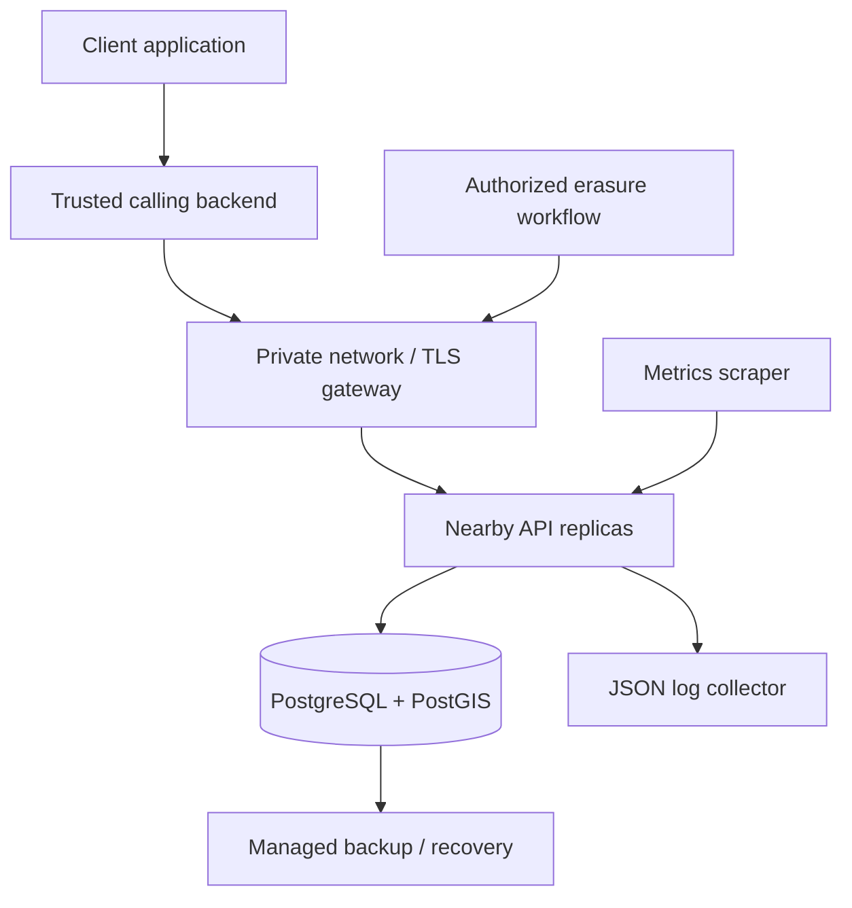
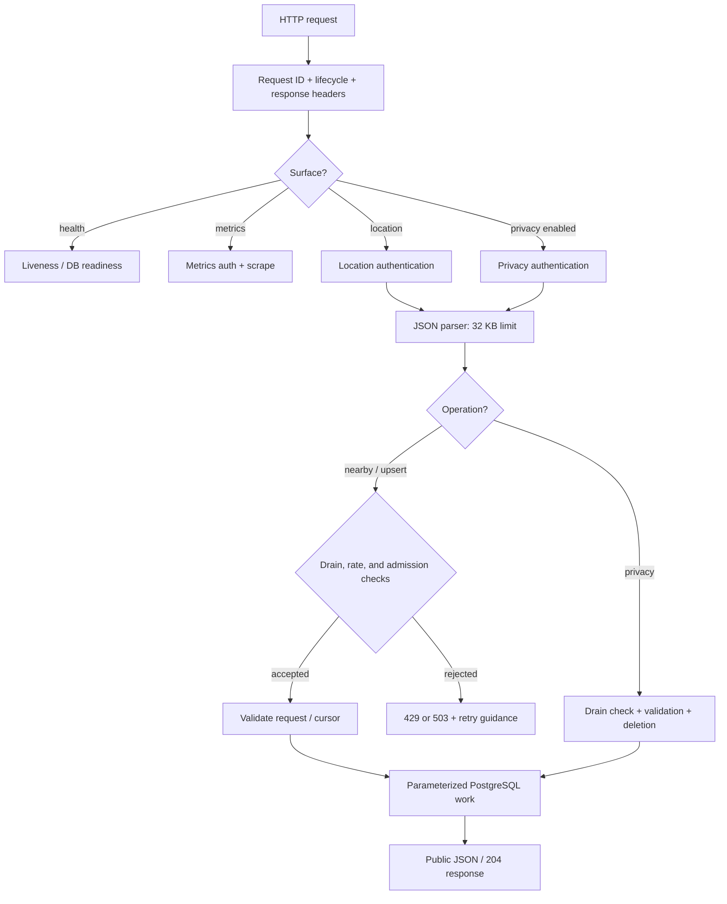
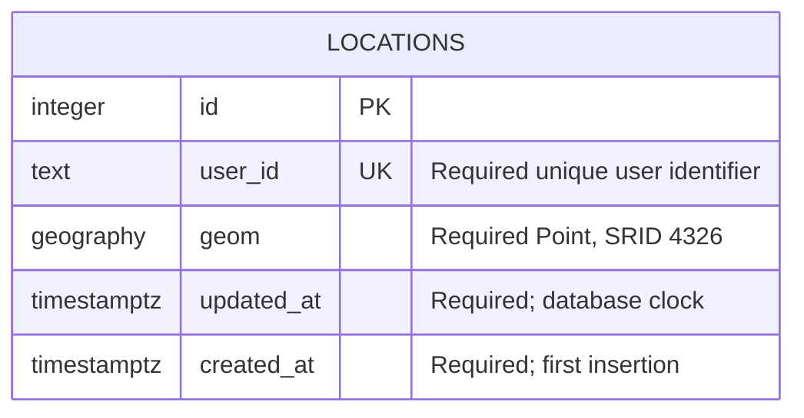
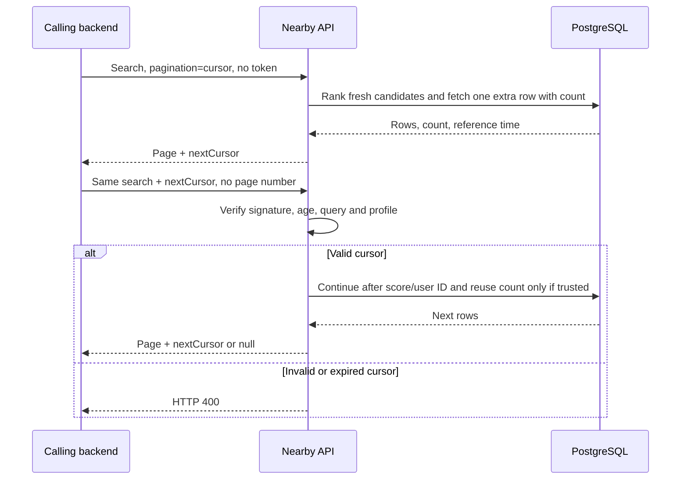
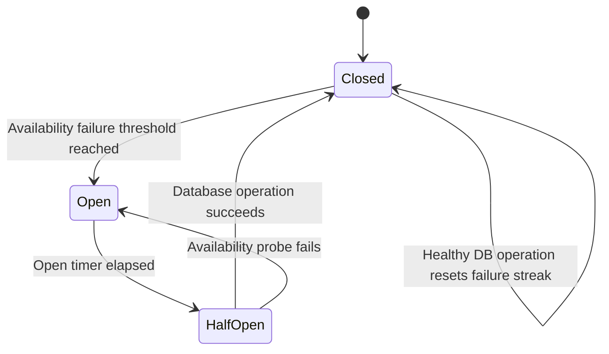
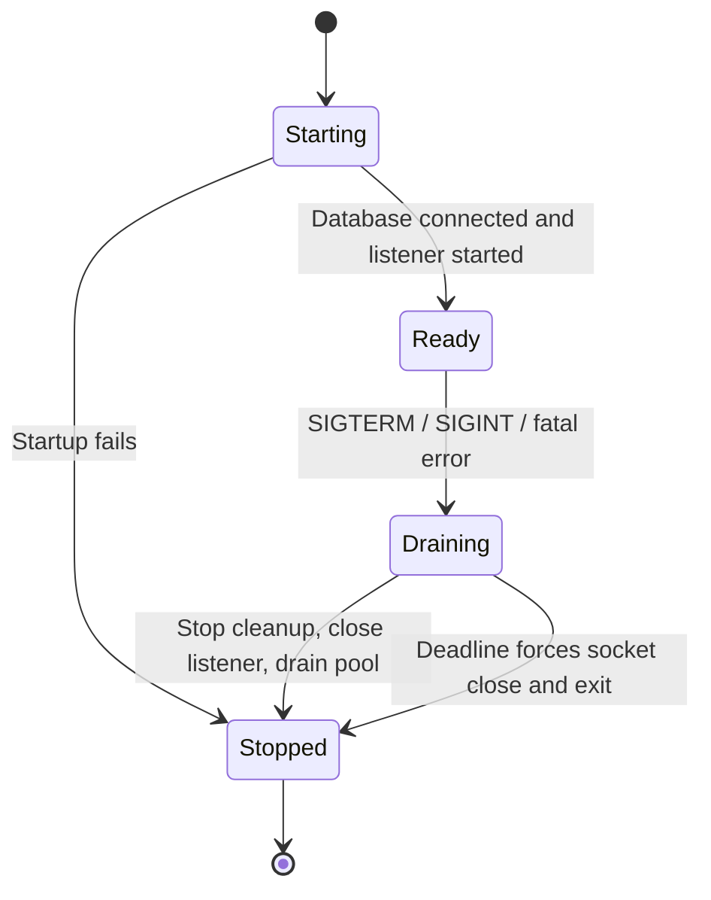

# Architecture

[Documentation index](README.md) · [Overview](OVERVIEW.md) · [Configuration](CONFIGURATION.md)

## System context

The API is a TypeScript/Express process backed by a shared PostgreSQL/PostGIS database. Horizontal replicas share database state and cursor keys, while admission, circuit, rate-limit, and metric state remain local to each process.

The gateway, callers, scraper, and backup service are deployment responsibilities. API replicas do not authenticate end users or apply user visibility policies. The backend must enforce them before allowing publication and coordinate disclosure.

## HTTP request routing

Middleware order matters: request identity and lifecycle tracking run first; response safety headers follow. Health is mounted before JSON parsing, and surface-specific authentication runs before request body parsing. Location handlers then acquire admission capacity before validating their request.

Authentication can return 401 before parsing. Parser/validation failures return 400, 413, or 415 as appropriate. Unknown or disabled routes return 404. Privacy deletion uses its own drain check and database error classification; it does not use the nearby/upsert admission or local rate limiter.

## Data model

The initial [migration](../migrations/1706300000000_init.js) creates the PostGIS extension and a single application table:

| Structure | Role |
|---|---|
| Primary key `id` | Internal row identity; omitted from API responses |
| Unique `user_id` | Enforces one current position per user |
| `geom geography(Point,4326)` | WGS84 point with distance calculations in meters |
| `locations_geom_gist_idx` | Supports radius candidate selection |
| `locations_updated_at_idx` | Supports stale-row selection for cleanup |

JSON uses `{lat, lng}`. PostGIS point construction uses **longitude first**: `ST_MakePoint(lng, lat)`. Extraction reverses this mapping with `ST_Y` for latitude and `ST_X` for longitude. `created_at` remains unchanged by an upsert; `geom` and `updated_at` are replaced using `INSERT ... ON CONFLICT`.

## Nearby SQL

The [model](../src/models/location.model.ts) constructs parameterized SQL with the following logical stages:

1. Build the search geography and ranking reference clock.
2. Filter with inclusive `ST_DWithin`, TTL, and optional excluded user.
3. Materialize candidate distances so `ST_Distance` is evaluated once per candidate.
4. Calculate ranking scores and sort by `score DESC, user_id ASC`.
5. Select the page, then extract result coordinates only for returned rows.
6. Map database rows into the public response; the score remains internal.

The GiST index allows spatial pruning, but PostgreSQL chooses the plan. A wide radius or small table can reasonably produce a sequential scan. Cursor pagination still evaluates and sorts eligible candidates; it does not guarantee constant-time queries. Use [query-plan and workload checks](TESTING.md#query-plan-analysis) for evidence.

Offset mode uses `COUNT(*) OVER()` and a fallback count when an offset beyond the end has no row to carry that count. Cursor mode fetches `pageSize + 1` rows to detect `hasMore`. A verified signed v3 cursor supplies the first-page count, avoiding a recount on subsequent pages. Older or unsigned cursor paths may recount.

## Ranking

The profile is process configuration, selected at startup. The stable profile ID hashes mode, distance scale, half-life, and weights. All replicas serving one cursor session should use the same profile and signing keys.

Let `d` be distance in meters and `t` be the update timestamp in Unix milliseconds.

**Legacy:** `score = 1 / (d + 1) + t / 10^10`.

This preserves historical ordering and is not normalized. Recency differences can outweigh distance differences. Ties are resolved by user ID ascending.

**Decay:** `score = (wd × exp(-d / scale) + wf × 0.5^(ageSeconds / (halfLifeMinutes × 60))) / (wd + wf)`.

Defaults are scale **2,000 m**, half-life **60 minutes**, distance weight **0.65**, and freshness weight **0.35**. Age is clamped at zero in the scoring expression; at least one weight must be positive. The eligible-row filter also excludes timestamps later than the pinned reference time in decay mode.

Legacy TTL uses the current database clock. Decay TTL and scores use a pinned database reference clock. Its first-page clock is truncated to milliseconds and advanced by one millisecond so cursor serialization does not alter scoring precision or omit a just-committed row in the same millisecond.

See [ranking comparison tooling](TESTING.md#ranking-comparison) before changing the mode or parameters. A profile change invalidates decay cursors and should be coordinated across replicas.

## Cursor pagination

New API cursors use v3: sort tuple, query hash, total count, original issuance time, and optional decay clock/profile. The signed wrapper is `s1.<base64url payload>.<HMAC-SHA256>`. The cursor is an opaque client contract, but its payload is readable; it is not encryption.

The query hash binds coordinate, radius, exclusion, and the decay profile. It does not bind page size. The original v3 session issuance time persists across pages; default lifetime is 60 minutes with a five-minute future-clock allowance. Unsigned v1/v2 can remain compatible when signatures are not required; with a signing secret configured, unsigned v3 is rejected even during compatibility mode.

Decay pins time, not the database contents. Upserts, erasure, and cleanup can change results between requests. Signed v3 `totalCount` describes the first page rather than the current table. See the [client traversal contract](API.md#cursor-traversal).

## Overload protection

Controls are applied per replica to nearby and upsert workloads: a drain check, optional IP/workload fixed-window rate limit, concurrency cap, PostgreSQL pool queue threshold, and availability circuit. Rate limiting and admission are independently configurable.

Half-open admission permits one probe at a time. Network/availability failures can trip the circuit; statement timeouts and transaction conflicts can be retryable without declaring the database unavailable. The classifier lives in [admission-core](../src/utils/admission-core.ts).

Optional adaptive admission starts at a fraction of the configured cap, observes database-operation latency through an EWMA, increases gradually after healthy samples, and reduces multiplicatively under latency, failure, or pool pressure. These are database-operation targets, not end-to-end HTTP SLO guarantees.

Admission capacity remains occupied until the asynchronous handler settles. Closing the client socket does not cancel PostgreSQL work. The privacy control plane must receive its own network/gateway protections.

## Maintenance and retention

Cleanup runs at process startup and on the configured cron schedule in the process timezone. A local overlap guard and a session-level PostgreSQL advisory lock ensure only one participating replica cleans at a time. The lock-owning connection is held throughout the run.

Each batch selects stale rows with `FOR UPDATE SKIP LOCKED`, applies transaction-local statement/lock timeouts, rechecks staleness during deletion, and commits independently. Batch size, delay, and run cap bound maintenance work. Uncertain lock or transaction state causes connection disposal. Read-time TTL remains effective if cleanup is delayed.

Hard privacy deletion removes the live row and leaves no tombstone. A later upsert can recreate it; see [privacy ordering](PRIVACY_AND_RETENTION.md).

## Process lifecycle

The server connects with bounded exponential retries before listening. It checks connectivity rather than schema existence. Direct Node starts require explicit migrations; the Docker entrypoint can run them first.

During drain, readiness fails immediately and new location work receives 503. The listener remains open briefly for routing propagation, then stops accepting connections. Keep-alive connections are closed as soon as their in-flight responses finish rather than after the idle keep-alive timeout. Cleanup starts no new batches while draining; the process waits for existing work and closes the pool. A total deadline forces exit if work remains hung. Platform termination grace must exceed the application's deadline plus any preStop delay.

Liveness tests the responding process. Readiness checks lifecycle and `SELECT 1`, and can report the circuit state; it does not itself prove the circuit is closed or the schema is installed.

## Source responsibilities

| Area | Source |
|---|---|
| Bootstrap and routing | [server](../src/server.ts), [app](../src/app.ts), [routes](../src/routes) |
| Validation and settings | [request schemas](../src/schemas/request.schema.ts), [coordinate schema](../src/schemas/coordinate.schema.ts), [environment](../src/config/env.ts) |
| Storage and ranking | [model](../src/models/location.model.ts), [ranking math](../src/utils/ranking.ts), [profile](../src/config/ranking.ts) |
| Cursor integrity | [cursor utility](../src/utils/cursor.ts) |
| Database and cleanup | [database utility](../src/utils/db.ts), [cleanup job](../src/jobs/cleanup.job.ts) |
| Admission and lifecycle | [admission adapter](../src/utils/admission.ts), [admission core](../src/utils/admission-core.ts), [lifecycle](../src/utils/lifecycle.ts) |
| Observability | [metrics](../src/utils/metrics.ts), [logger](../src/utils/logger.ts), [HTTP instrumentation](../src/middleware/observability.middleware.ts) |
| OpenAPI and human-readable age | [Swagger configuration](../src/config/swagger.ts), [relative time](../src/helpers/timeAgo.helper.ts) |

The repository's [deployment scripts](../deploy) and [CI](../.github/workflows/ci.yml) are supporting automation; they do not establish acceptance of an untested production environment.
