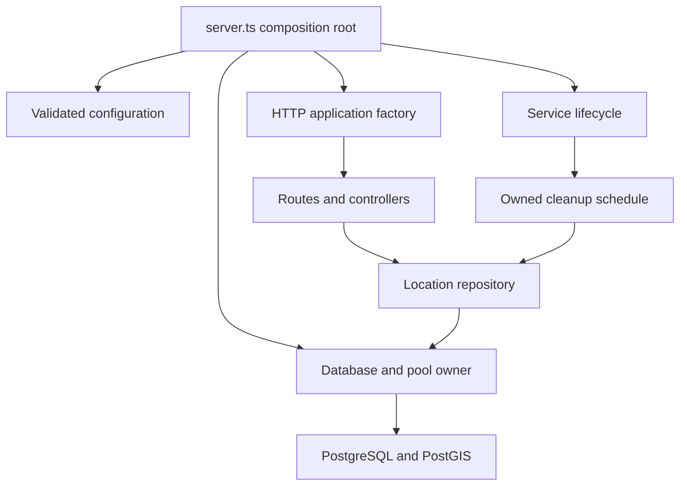

# Architecture and lifecycle

[Documentation index](../README.md)

## Composition and ownership

The service has one HTTP process, one owned PostgreSQL pool, one location repository and one cleanup schedule. Locations live in PostGIS, not in process memory. The executable `server.ts` loads configuration and constructs these objects explicitly. Importing application modules does not load `.env`, open sockets, create a pool or schedule cleanup.

| Module | Responsibility |
| --- | --- |
| `src/server.ts` | Executable composition root; load settings and construct dependencies |
| `src/runtime.ts` | Resource startup/draining and the process signal adapter |
| `src/app.ts` | Build an isolated Express instance from explicit dependencies |
| `src/config/env.ts` | Pure `parseConfig(values)` and explicit `loadConfig()` |
| `src/routes/` | Mount the four existing HTTP operations |
| `src/controllers/` | Validate input, invoke dependencies and serialize responses |
| `src/schemas/` | Coordinate, identifier and per-instance search validation; compatible error formatting |
| `src/models/location.model.ts` | Typed `LocationRepository` and parameterized spatial queries |
| `src/utils/db.ts` | Pool configuration, connection probes/retries, cancellation and disposal |
| `src/jobs/cleanup.job.ts` | Non-overlapping deletion passes, bounded batches and schedule disposal |
| `src/config/openapi.ts` | Single explicit OpenAPI contract; no route-source scanning |
| `src/config/swagger.ts` | Instance-specific UI options and specification endpoint |
| `src/middleware/swagger-auth.middleware.ts` | Dedicated documentation authentication |
| `src/middleware/request-context.middleware.ts` | Per-request language negotiation, reference timestamp and response language/cache headers |
| `src/i18n/` | Supported languages and typed human-readable API messages |

The application factory accepts only the repository operations and database health operation used by HTTP. The repository accepts a query-capable pool and its TTL. Tests provide isolated implementations of these interfaces; no application singleton is modified. This keeps the dependency boundaries small without introducing a separate service layer for operations that only delegate to persistence.

## Startup

The executable reads `.env` once and validates configuration before constructing runtime resources. `DATABASE_URL` is required; there is no default username/password fallback. The application factory applies the validated Express mode and suppresses the framework version header.

The process signal adapter is installed before the connection probe begins. Startup probes PostgreSQL with `SELECT 1` and uses bounded exponential retry delays. Failed probe clients are discarded, successful ones are released, and cancellation prevents another retry. An in-flight pool acquisition or query still observes its configured database timeout before it can be released.

Only after the probe succeeds does the lifecycle open HTTP. Cleanup starts only after listener binding succeeds. Its first deletion pass is asynchronous and does not block readiness logging. A startup failure drains any acquired listener/job and closes the pool before reporting failure.

The Docker entrypoint applies migrations before starting this executable. Direct Node execution requires an explicit migration step. See [Deployment](DEPLOYMENT.md).

## Request processing

Express verifies raw UTF-8 before JSON decoding and parses JSON with the existing 32 KiB limit. Distinct malformed byte sequences cannot collapse into the same identifier. The check runs after decompression; valid Unicode and supported UTF-16 transports remain accepted. Health liveness answers directly; readiness invokes the injected database probe and still checks only `SELECT 1`.

Location schemas trim and validate identifiers and check coordinates, radius and pagination. Body fields override query fields. Each application instance has its own radius schema and Swagger settings. Validation failures retain the public `_errors` tree, including nested coordinate fields, while internal failures remain generic to callers.

The repository preserves the existing SQL: upsert writes `[userId, lng, lat]`; nearby filters radius, TTL and exclusion before the existing distance/recency score, window count and pagination. Coordinate projection happens only for page rows. An empty page with a positive offset performs the existing count fallback. Cleanup uses the same repository TTL as searches. No database schema or query semantics changed.

Request-context middleware captures one trusted server instant and negotiates English or Persian before JSON parsing or database work. The controller passes this immutable, request-local context to validation and display formatting. The helper uses cached native relative-time formatters and computes month/year anniversaries in the UTC Gregorian calendar with month-end clamping in both languages. Display age is recomputed on every request and is never stored. Invalid timestamps fail instead of producing invalid text. The exact `updatedAt` value is not mutated.

The typed message catalog owns API wording. Each application instance constructs both language-specific schemas once; per-parse error maps handle validator defaults without mutating Zod's global locale. Concurrent requests therefore retain independent languages. Response language and cache-variation headers are set before parsing so client and internal errors follow the same language selection.

## Shutdown

SIGTERM/SIGINT cancel startup/retry work, stop scheduling, close the HTTP listener, and wait for active HTTP requests and the current cleanup batch. No new cleanup batch starts after stopping is requested. The schedule is destroyed after its active work settles, including the scheduler-error path. The pool closes after HTTP and cleanup draining.

Startup, stop and database disposal share their respective in-flight promises. Repeated termination signals do not run disposal twice. The executable sets an exit status after cleanup and lets Node drain its remaining work rather than exiting while cleanup is active. Errors still produce status 1. The container manager supplies the existing 60-second grace period; there is no new internal shutdown-timeout setting.

## Contract and distribution

One explicit TypeScript definition produces both the live and exported OpenAPI. Runtime Swagger uses validated settings; canonical export receives fixed server/radius settings without reading credentials. UI initialization middleware is created per app, so request-execution flags cannot bleed between instances. Basic Auth protects documentation only; deployment access controls still protect the location API.

The production image installs the locked production graph and copies compiled JavaScript, migrations and the migration wrapper. It needs no TypeScript source, annotation parser or development watcher. See [Testing](TESTING.md) and [Release validation](VALIDATION.md) for verification and remaining limits.
