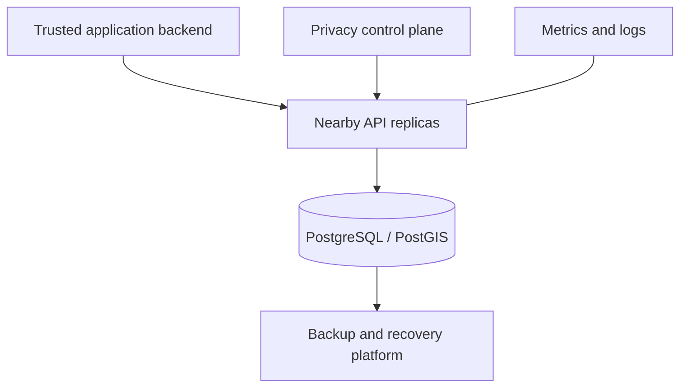

# Nearby Location — presentation and speaker notes

[Documentation index](README.md) · [Overview](OVERVIEW.md) · [Architecture](ARCHITECTURE.md)

**Audience:** engineering, product, and operations stakeholders. **Duration:** approximately 12–15 minutes plus questions. **Source presented:** package version 2.14.0; pair it with its reviewed commit/image digest. Use synthetic data for the demo and insert your own accepted commit/image and environment evidence where indicated.

Each section contains concise slide content and a spoken explanation. The technical diagrams render in GitHub; the architecture guide provides additional diagrams for questions.

## Slide 1 — Purpose

**On the slide**

- One shared capability for current user locations and nearby discovery.
- WGS84 coordinates, meter-based radius, fresh results.
- Node.js 24 / TypeScript / Express / PostgreSQL + PostGIS.

**Speaker notes**

“Nearby Location gives our application a focused way to publish a user's current position and discover users near a point. We separate this capability into a service so callers share the same spatial rules, freshness policy, ranking, and pagination. The caller still owns identity, consent, and who is allowed to see a position.”

## Slide 2 — Product workflow and scope

**On the slide**

| Step | Result |
|---|---|
| Publish user location | One current row is created or replaced |
| Search a point and radius | Fresh eligible users are selected and ranked |
| Consume a page | Stored coordinates, distances, and update times are returned |
| Expire or erase | Read eligibility and live storage follow separate lifecycle rules |

**Speaker notes**

“A trusted backend submits a user ID and coordinate. A second request supplies a search center and radius, optionally excluding the requesting user. The response includes the actual stored coordinate of each match. This service stores current state; movement history, maps, geocoding, and user visibility policy belong to other application components.”

## Slide 3 — Architecture

**On the slide**



**Speaker notes**

“The application process is intentionally small: Express routes and TypeScript logic talk to one PostgreSQL source of truth. PostGIS handles spatial eligibility and distance. Replicas share database state and cursor keys, while overload controls remain local to each replica. The operating platform provides transport, secret management, monitoring, and recovery.”

## Slide 4 — How nearby search works

**On the slide**

1. Authenticate the service and admit work.
2. Validate coordinate, radius, pagination, and cursor.
3. Select candidates with `ST_DWithin`, TTL, and exclusion.
4. Calculate distance and ranking, then select the page.
5. Return public result fields.

**Speaker notes**

"The radius boundary is inclusive and uses geography distances in meters. A GiST index supports candidate selection. SQL materializes candidate distances and delays coordinate extraction until after page selection. TTL filtering runs even if cleanup has not run; decay continuation uses its pinned reference time. Index use and query speed depend on the dataset and radius, so we validate actual plans rather than assuming every search is cheap."

## Slide 5 — Ranking choices

**On the slide**

| Mode | Behavior | Use |
|---|---|---|
| Legacy, default | Historical distance-plus-timestamp score | Preserve existing ordering |
| Decay, opt-in | Weighted distance decay and freshness half-life | Tune distance/freshness relevance explicitly |

Decay defaults: 2 km distance scale, 60-minute freshness half-life, weights 0.65 / 0.35. Ties use user ID ascending.

**Speaker notes**

“Nearby does not simply mean nearest-first. We combine distance and freshness. Legacy keeps existing behavior; decay provides explicit distance and age controls. Before changing modes, we compare rank changes on representative data and agree on relevance. Ranking configuration is fleet-wide, and a decay profile change invalidates existing decay cursors.”

## Slide 6 — Pagination and response

**On the slide**

- Offset pages for page-number navigation.
- Keyset cursors for continuation without deep offsets.
- HMAC signing, search binding, lifetime, and key rotation.
- Result: user ID, stored coordinate, meter distance, timestamp, English age.

**Speaker notes**

“Clients can keep page numbers or use the next cursor supplied by the service. Signed v3 cursors preserve the first-page count, so later pages avoid recounting that candidate set. Decay also pins the ranking clock. This is live data, however: location changes and deletion can affect later pages. A cursor does not promise a database snapshot, and signing does not encrypt its payload.”

## Slide 7 — Reliability and observability

**On the slide**

- Bounded concurrency and pool-pressure rejection.
- Database availability circuit; optional adaptive limits.
- Readiness, graceful drain, and total shutdown deadline.
- Request IDs, structured logs, Prometheus metrics.

**Speaker notes**

“When demand or database pressure rises, the service can reject work deliberately with retry guidance rather than allowing an unbounded queue. Adaptive admission can reduce local limits when database operation latency rises. We monitor useful accepted throughput, latency, and rejections together. Adding replicas still adds connection demand; autoscaling must stay within the database budget.”

Use the [request/circuit/lifecycle diagrams](ARCHITECTURE.md) when discussing resilience in detail.

## Slide 8 — Security and privacy lifecycle

**On the slide**

- Independent credentials for location, metrics, privacy, and docs.
- Caller authorization for IDs and exact coordinates.
- Read-time TTL plus bounded physical cleanup.
- Stop publisher → drain events → erase live row.
- Backup retention and restore-time erasure replay.

**Speaker notes**

“Bearer authentication identifies the calling service, so end-user authorization remains essential. Retention has two parts: hiding expired locations in reads and removing them physically. Erasure removes the live row, but a later publication can recreate it. We therefore stop publishers and delayed events first. Backups are governed separately, and restoring older data requires replaying erasures before access resumes.”

## Slide 9 — Deployment and release

**On the slide**

- Development Compose and an authenticated isolated VM profile.
- Production container and adapted Kubernetes manifests.
- Separate migration Job before Kubernetes rollout.
- Capacity → migration → isolated canary → promotion → read-only smoke.
- Image rollback with backward-compatible schema/configuration.

**Speaker notes**

“The repository gives us a repeatable deployment path, including a VM evaluation profile and Kubernetes resources. Cluster upgrades use a published immutable image. The release script checks capacity, runs migrations, evaluates an isolated canary, and promotes the candidate. It can attempt an application image rollback, but database migrations and external configuration are not automatically reversed.”

For detail, show the [release-flow diagram](../deploy/kubernetes/release/README.md#release-flow). The script upgrades an existing installation; use the deployment guide for first installation.

## Slide 10 — Evidence and launch decision

**On the slide**

| Evidence | Populate for your accepted release |
|---|---|
| Commit / immutable image | Exact SHA and digest |
| CI and integration | Current workflow outcome |
| Workload | Dataset, radius, request mix, concurrency, duration |
| Performance | Accepted RPS, success-path p95/p99, errors/rejections |
| Capacity and recovery | Pool budget, restart/failover, restore RPO/RTO |
| Governance | Access, retention, alerts, and operating owners |

**Speaker notes**

“The implementation includes the controls and tooling needed to evaluate a release, but production acceptance depends on the actual environment. Our launch decision uses the exact image and configuration, representative workload evidence, recovery rehearsal, and ownership of privacy and operations. Historical benchmarks are useful context; they are not a substitute for current acceptance.”

Use the [production gate record](PRODUCTION_READINESS.md) for the decision. Do not replace these evidence placeholders with invented capacity numbers.

## Two-minute demo

Prepare an isolated local environment using the [README quick start](../README.md#start-a-local-environment). Check readiness and open Swagger before presenting. Use these synthetic examples with local auth disabled:

```bash
curl --fail-with-body http://localhost:8080/location/upsert \
  -H 'Content-Type: application/json' \
  -d '{"userId":"presentation_user_a","coordinate":{"lat":35.6892,"lng":51.389}}'
curl --fail-with-body http://localhost:8080/location/upsert \
  -H 'Content-Type: application/json' \
  -d '{"userId":"presentation_user_b","coordinate":{"lat":35.6902,"lng":51.389}}'
curl --fail-with-body http://localhost:8080/location/nearby \
  -H 'Content-Type: application/json' \
  -d '{"coordinate":{"lat":35.6892,"lng":51.389},"maxDistance":1000,"pagination":"cursor","pageSize":1}'
```

Point out the stored result coordinate, distance, timestamp/age, `hasMore`, and `nextCursor`. Copy the returned cursor into the next request with the same search and no `page`. Do not promise which user ranks first because recency contributes to ranking. Finish with the second page and show the documented privacy flow; execute erasure only in an isolated profile where it is enabled with its dedicated token.

## Questions to anticipate

| Question | Answer |
|---|---|
| Why PostGIS? | The implementation uses geography, spatial filtering, indexes, and meter-based distances in the database. |
| Does it track movement history? | It stores one current position per user. |
| Are results sorted strictly by nearest distance? | Both modes combine distance and freshness. |
| Does a cursor freeze the data? | Decay freezes the scoring clock; table contents remain live. |
| Does the service authorize end users? | Tokens identify services; the caller enforces ownership and visibility. |
| Can we scale by adding replicas? | Replicas help only within database/query capacity; budget every pool. |
| Does erasure remove backups? | Live deletion and backup expiry/recovery erasure are separate processes. |
| Is production readiness proven by CI? | CI covers source/container regressions; target workload, access, and recovery require environment evidence. |
