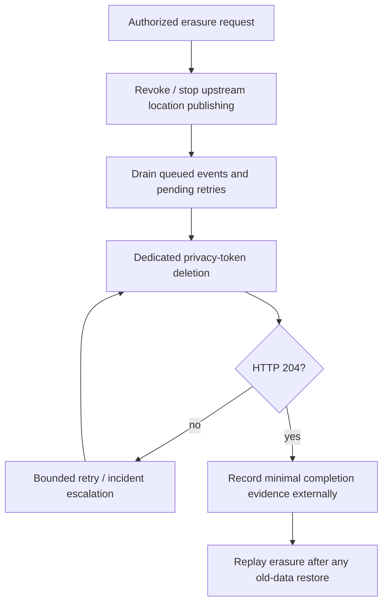

# Location privacy and retention

[Documentation index](README.md) · [Security](SECURITY.md) · [Backup/restore](runbooks/BACKUP_RESTORE.md)

## Data and ownership

The live `locations` table contains a user identifier, precise current position, last-update timestamp, first-created timestamp, and internal row ID. Nearby responses disclose the matched identifier and exact position. The application owns consent, end-user authorization, visibility, retention approval, and erasure evidence.

This service stores current location rather than movement history. Backups, WAL, logs, or downstream copies can nevertheless retain earlier state and require separate policies.

## Live retention

`LOCATION_TTL_DAYS` defaults to seven days. Query-time filtering makes older positions ineligible even when they remain physically stored. Legacy queries measure freshness against current DB time; decay cursors use their pinned reference clock for eligibility/scoring. A cursor session is not a continuously refreshed TTL snapshot and can use an older reference until it expires; physical cleanup may remove those rows meanwhile. Set TTL and cursor lifetime coherently with the product's freshness requirement.

Physical cleanup runs at startup and on `CLEANUP_CRON_SCHEDULE`, default 03:00 in the process timezone. Local overlap protection and a PostgreSQL advisory lock coordinate replicas. Independent bounded transactions select stale rows, skip locked rows, recheck staleness, delete, and commit. Timeouts, delay, and batch/run caps limit work.

Cleanup lag does not disable read-time filtering, but it affects physical retention. Schedule and batch capacity must handle the expected stale-row volume. A successful delete removes the live row logically; PostgreSQL dead-tuple reclamation, backups, replicas, and storage-media lifecycle are separate concerns.

## Retention audit

```bash
NODE_ENV=production npm run privacy:audit
```

The audit reads aggregate counts only. It does not delete rows. Configure the DB/TLS settings securely and select policy thresholds:

| Audit control | Default | Meaning |
|---|---|---|
| `LOCATION_TTL_DAYS` | 7 | Live-data expiry policy |
| `PRIVACY_AUDIT_CLEANUP_GRACE_HOURS` | 48 | Allowed lag beyond TTL before a row is overdue |
| `PRIVACY_AUDIT_MAX_OVERDUE_ROWS` | 0 | Maximum accepted overdue count |
| `PRIVACY_AUDIT_FUTURE_TOLERANCE_MINUTES` | 5 | Future timestamp allowance |
| `PRIVACY_AUDIT_MAX_FUTURE_ROWS` | 0 | Maximum accepted future-row count |

A failed verdict exits 2; configuration/execution failure exits 1. The 48-hour audit grace is an operational default, not an approved retention extension. Review it with the data owner and alert on audit failures. The [CronJob example](../deploy/kubernetes/privacy-audit-cronjob.example.yaml) is optional and excluded from base installation.

## Explicit erasure

Enable the privacy API only for an authorized workflow with its own token. `POST /privacy/location/delete` (or `POST /privacy/location/delete-exact` for an exact stored identifier) hard-deletes the current row and returns the same 204 whether or not it existed. It leaves no tombstone or publisher revocation state.



Stop publication before deletion; otherwise a delayed or future upsert can recreate the row. The endpoint does not inspect upstream queues, revoke consent, or erase downstream caches/backups. Those actions must be coordinated by the external workflow.

Deletion bodies keep the identifier out of the URL. Each erasure deletes at most one stored identity. `POST /privacy/location/delete` follows upsert's normalized identifier rules, including trimming; control characters and ill-formed Unicode are rejected. `POST /privacy/location/delete-exact` deletes the stored identifier byte-for-byte, for example one stored with control characters before 2.13.1 or copied from a nearby result. Neither route falls back to the other. Builds without the exact route answer 404 without deleting anything; the erasure workflow must record that as "not performed" and retry, not as completed. Version 2.14.0 includes this route; older supplied builds shared version 2.13.5, so still identify deployed binaries by commit/image digest. See [the API reference](API.md#erase-a-current-location) and [rollout guidance](OPERATIONS.md#rolling-out-exact-erasure). Application logs record aggregate outcome and request ID without the identifier. If your audit process needs subject correlation, maintain it in a separate restricted system with an approved lifetime. The database deletion alone is not the complete user-erasure process.

## Backups, WAL, and restore

Define separate backup/PITR retention, encryption, access, and expiry. A live deletion does not edit an existing immutable backup. A restore can resurrect previously erased users and expired rows. Before releasing restored data, keep publishing paused, replay relevant erasures/revocations from the authorized external record, audit retention, and validate eligibility. See [backup/restore](runbooks/BACKUP_RESTORE.md).

## Logs, metrics, and downstream systems

Metrics use bounded labels and no user/coordinate dimensions. Production logs suppress raw DB messages/stacks and redact sensitive named fields. Review gateway request-body capture, APM, database statement/parameter logging, BI exports, debugging, and support archives independently.

Cursors can contain readable user identifiers despite signing. Ranking comparisons and full query plans are internal diagnostic data, not anonymous telemetry. Prefer synthetic datasets for testing and presentations; never put real location samples into the repository.

## Policy acceptance

Before launch, record approved TTL, physical-cleanup lag, cursor-session freshness expectations, consent/visibility rules, erasure ownership, upstream stop/drain semantics, downstream retention, backup expiry, restore-time erasure replay, audit thresholds/schedule, admin access, and incident owner. Validate the workflow using synthetic subjects, including delayed publications and restoration.

Source: [model](../src/models/location.model.ts), [cleanup job](../src/jobs/cleanup.job.ts), [privacy controller](../src/controllers/privacy.controller.ts), [audit script](../scripts/audit-privacy-retention.js).
